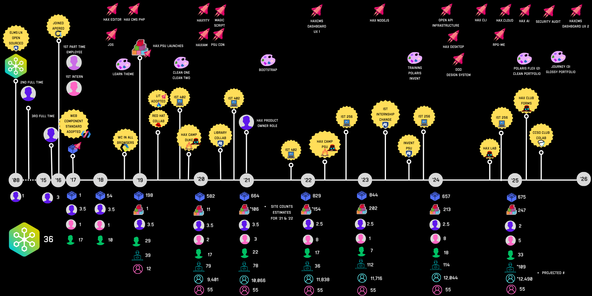
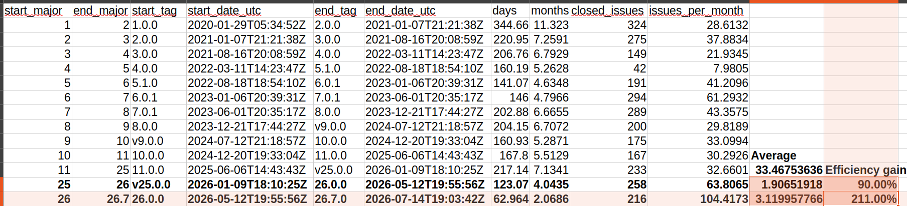

# Visuals

Impact visuals that back up `WINS.md`. Each one lists its source talk and alt text so agents and authors can reuse it accessibly.

## SIIP timeline, 2008–2026

- **File:** `siip-timeline-2008-2026.png`
- **Source:** *The Sustainable Impact and Innovation Pipeline (SIIP), a Conversation with HAX* (Ollendyke, Frank, Fusco, Rose), [Apereo microconference recording, May 2026](https://www.youtube.com/watch?v=TNF0uzYi9Kk)
- **Alt text:** Timeline from 2008 to 2026 of the HAX and ELMS:LN projects. Rockets mark major features (HAX editor, HAXcms PHP and Node.js, HAXiam, PSU CDN, HAX CLI, hax.cloud, HAX AI, DDD design system, security audit, dashboard UX). Palettes mark themes. Yellow badges mark community milestones (ELMS:LN open sourced, Apereo, web components standard, Red Hat collaboration, HAX Camp at Duke and Penn State, IST courses, HAX Lab, HAX Club, CCSO club collaboration). Yearly counts run along the bottom.
- **Story:** in the talk version, blue circles mark work by core Penn State staff and red circles mark work with student involvement. Red dominates from 2022 on, after Bill Rose joined as product owner and the pipeline started.
- **Legend (bottom row):** blue block, web components; stacked blocks, sites; purple, full-time Penn State staff; pink, student interns; green, contributors at large; coder, students in Bryan's classes; teal, students educated that semester through HAX-based systems in Arts and Architecture (an undercount); pink outline, faculty and staff using HAX (estimate).

## Issue velocity by HAX version

- **File:** `hax-issue-velocity-by-version.png`
- **Source:** *The Many Mes*
- **Alt text:** Table of HAX versions 1 through 26.7 with start and end dates, closed issues and issues closed per month. Versions 1 to 25 average about 33.5 issues per month. Version 25 to 26 reached about 63.8 per month (90% gain); 26.0 to 26.7 reached about 104.4 per month (211% gain), after agents were given PRAW context.
